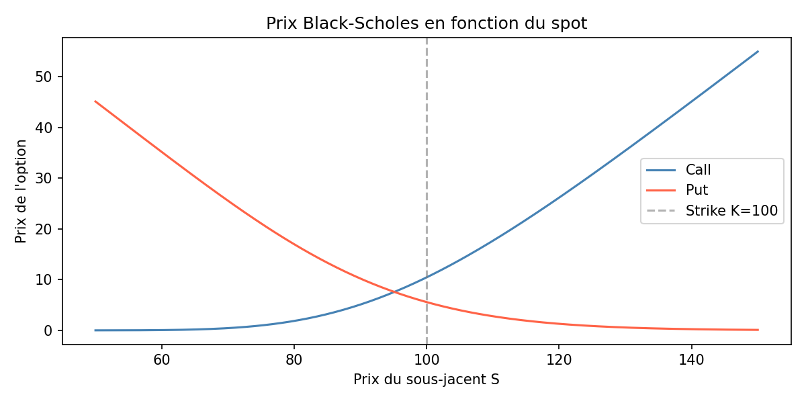
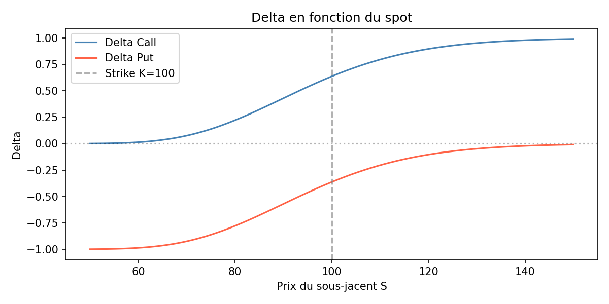
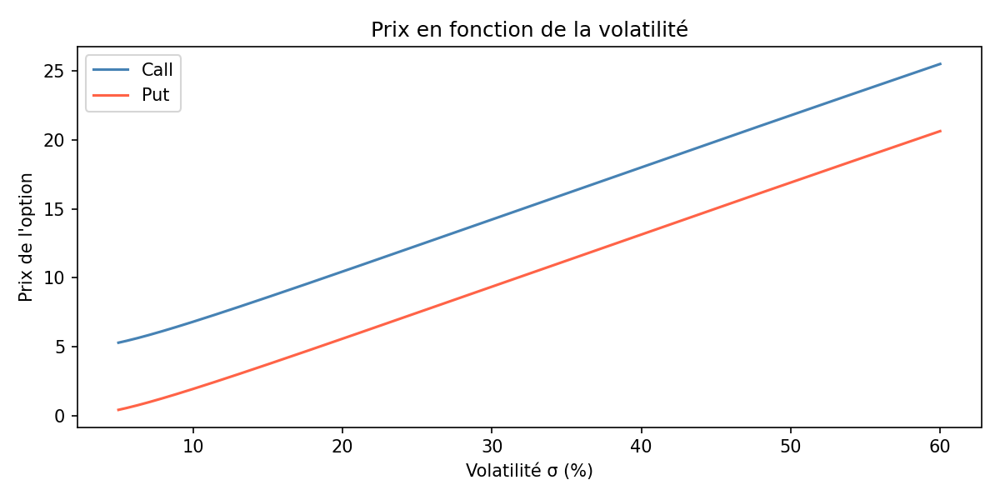

# Black-Scholes Option Pricing Engine

> Analytical pricing of European options with full Greeks computation and Monte Carlo validation.
For my first quantitative finance project, I decided to start from the ground up by implementing the Black-Scholes model from scratch — the cornerstone of derivatives pricing. Rather than using existing libraries, everything is built manually : closed-form pricing, all five Greeks, and a Monte Carlo simulation to validate the analytical results numerically. A foundation before moving on to portfolio optimization and volatility modeling.
---

## Overview

This project implements the **Black-Scholes model** from scratch in Python for pricing
European call and put options. It computes all five option sensitivities (Greeks) via
closed-form formulas, and validates results numerically using **Monte Carlo simulation**
over 100,000 paths.

Built as part of a quantitative finance portfolio targeting derivatives pricing and
risk management.

---

## Theory

### Black-Scholes Formula

Under the assumption that the underlying follows a **Geometric Brownian Motion** :

$$S_T = S_0 \cdot \exp\left(\left(r - \frac{\sigma^2}{2}\right)T + \sigma\sqrt{T}\,Z\right), \quad Z \sim \mathcal{N}(0,1)$$

The fair price of a European call is given by :

$$C = S \cdot N(d_1) - K \cdot e^{-rT} \cdot N(d_2)$$

$$d_1 = \frac{\ln(S/K) + (r + \sigma^2/2)\,T}{\sigma\sqrt{T}}, \qquad d_2 = d_1 - \sigma\sqrt{T}$$

And the put price follows from **put-call parity** :

$$P = C - S + K \cdot e^{-rT}$$

### Greeks

| Greek | Measures sensitivity to | Formula (call) |
|-------|--------------------------|----------------|
| **Δ Delta** | Underlying price S | N(d₁) |
| **Γ Gamma** | Rate of change of Delta | N'(d₁) / (S·σ·√T) |
| **Θ Theta** | Time decay (per day) | [−S·N'(d₁)·σ/(2√T) − r·K·e^(−rT)·N(d₂)] / 365 |
| **V Vega** | Volatility σ (per +1%) | S·N'(d₁)·√T / 100 |
| **ρ Rho** | Interest rate r (per +1%) | K·T·e^(−rT)·N(d₂) / 100 |

### Monte Carlo Validation

The same price can be estimated by simulating N paths of the underlying and
averaging discounted payoffs :

$$\hat{C} = e^{-rT} \cdot \frac{1}{N}\sum_{i=1}^{N} \max(S_T^{(i)} - K,\ 0)$$

Convergence to the analytical price is guaranteed by the **Law of Large Numbers**.
A 95% confidence interval is reported alongside each estimate.

---

## Results

Parameters used : **S = 100, K = 100, T = 1y, r = 5%, σ = 20%**

### Pricing

| Method | Call | Put |
|--------|------|-----|
| Black-Scholes (analytical) | **10.4506** | **5.5735** |
| Monte Carlo (100k paths) | 10.4398 | 5.5640 |
| Absolute error | 0.0108 | 0.0095 |

Monte Carlo error < 0.1% — consistent with the theoretical convergence rate of O(1/√N).

### Greeks

| Greek | Call | Put | Interpretation |
|-------|------|-----|----------------|
| **Delta** | +0.6368 | −0.3632 | Call gains 0.64€ per +1€ on the underlying |
| **Gamma** | 0.0188 | 0.0188 | Delta increases by 0.019 per +1€ on S |
| **Theta** | −0.0152 | −0.0065 | Call loses 1.5 cents per day (time decay) |
| **Vega** | +0.3752 | +0.3752 | Both gain 0.38€ per +1% volatility |
| **Rho** | +0.5323 | −0.4143 | Call gains 0.53€ per +1% interest rate |

### Sensitivity Analysis


*Call and put prices as a function of the underlying spot price.*


*Delta convergence : call delta → 1 deep in-the-money, → 0 deep out-of-the-money.*


*Both call and put prices increase with volatility — Vega is always positive.*

---

## Project Structure

```
black_scholes/
├── black_scholes.py   # Closed-form pricing + Greeks
├── monte_carlo.py     # Monte Carlo simulation + confidence intervals
├── plots.py           # Sensitivity visualizations
└── main.py            # Entry point — prints all results
```

---

## Usage

```bash
# Install dependencies
pip install numpy scipy matplotlib

# Run pricing and Greeks
python main.py

# Generate sensitivity plots
python plots.py
```

---

## References

- Black, F. & Scholes, M. (1973). *The Pricing of Options and Corporate Liabilities*. Journal of Political Economy.
- Hull, J. (2022). *Options, Futures, and Other Derivatives* (11th ed.). Pearson.
- Glasserman, P. (2003). *Monte Carlo Methods in Financial Engineering*. Springer.